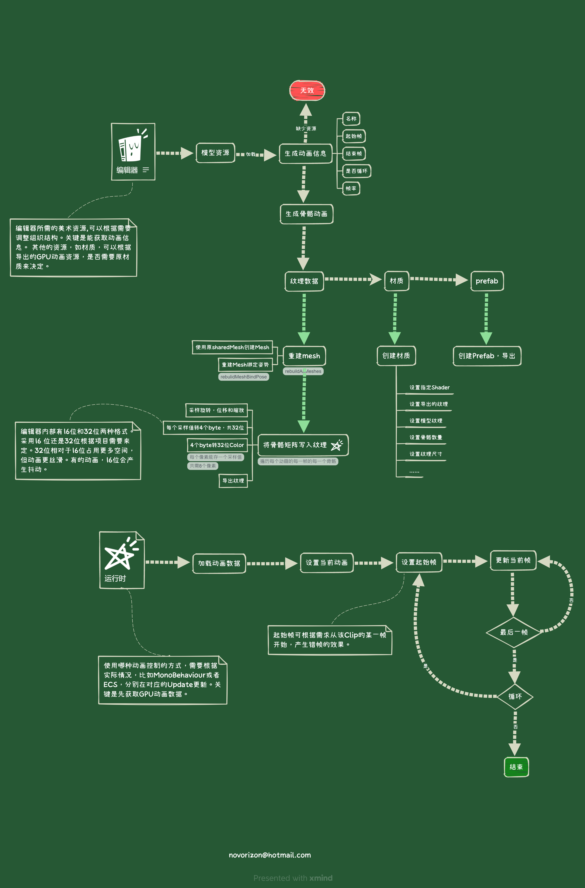

# GpuAnimator

GPU animation uses a rotation quaternion, translation and one uniform scale per
bone, followed by four-weight linear blend skinning. Use matching X/Y/Z scale;
independent axis scale and shear are outside this data format.

## Playback

The business layer supplies the animation name from its state or configuration.
After animation data has loaded through `AddAnimationComponent`, start a clip:

```csharp
bool started = GpuAnimator.TryPlay(entity, clipName);

// Optional per-instance settings; shared clip data is never changed.
bool startedOnce = GpuAnimator.TryPlay(entity, clipName, loop: false);
bool startedStaggered = GpuAnimator.TryPlay(entity, clipName, randomizeStart: true, loop: true);
```

`TryPlay` returns `false` for unavailable names, data that has not loaded, or
invalid playback metadata. It starts at the first frame unless `randomizeStart`
is enabled. With no loop override, the baked clip setting is used. The optional
completion callback runs once for a non-looping animation. Call playback APIs
when the animation state changes, rather than restarting a clip every update.

The existing `Play(entity, name, callback, userdata)` API remains available and
retains randomized starting phases. The name is always provided by its caller.
Looping now follows the baked setting; use `TryPlay(..., loop: true)` when the
business requires an explicit override.

## Updating baked assets

Rebake existing animation textures after updating. Uniform scale is now stored
directly instead of clamping the scale vector's magnitude, and byte decoding
matches the encoder's binary fractions. Old textures cannot recover scale
values already lost during baking.

## Framework integration

Framework integration is a separate step. Adapt resource loading and instance
lifecycle at the boundary, including protection against late load callbacks
after an instance is recycled. Keep animation selection in business code and
reuse shared baked assets and materials. Cache instance renderers and property
blocks in the update path; resource-loading interfaces and asynchronous work
belong outside the per-frame skinning path.


